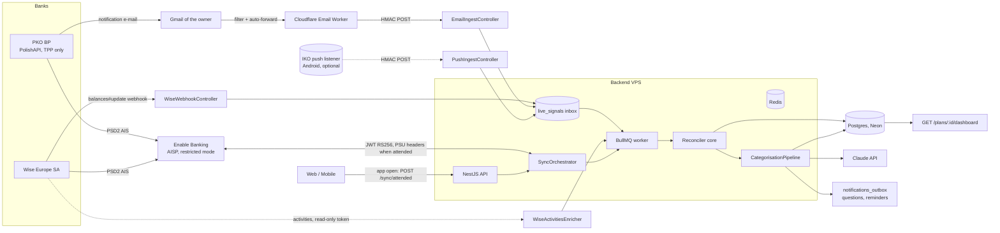
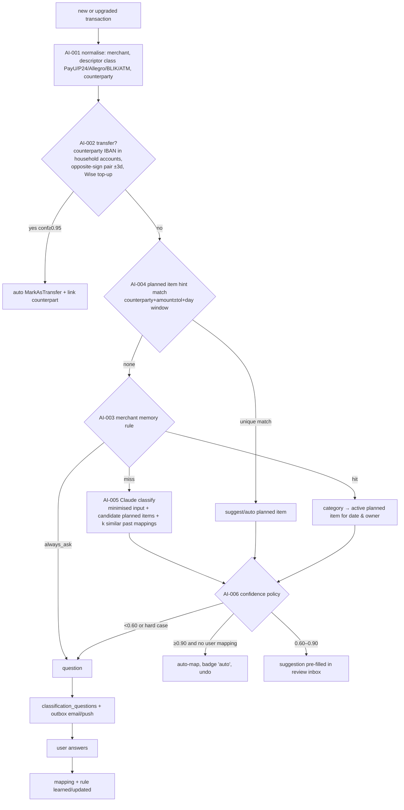
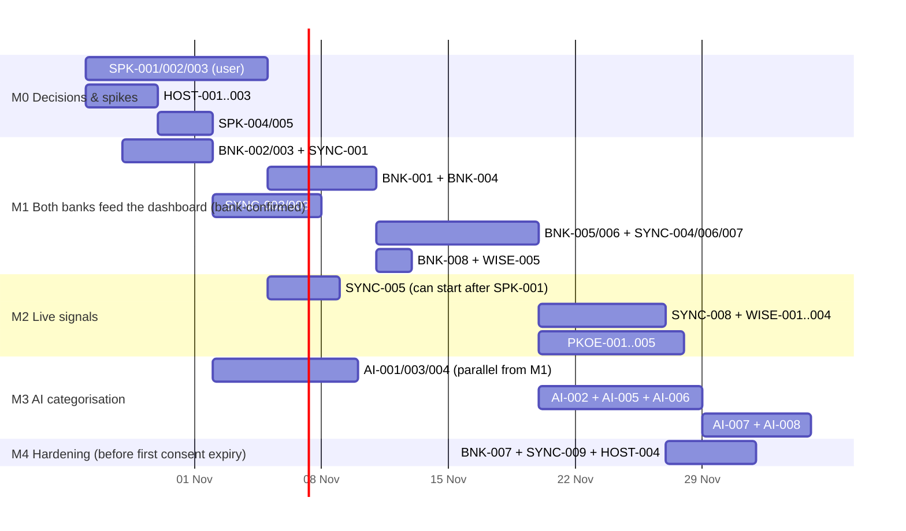

# Plan: real bank feeds for Power Budget (PKO BP + Wise), live signals, AI categorisation

- **Status:** design and implementation plan only. No code changes in this task.
- **Date:** 2026-10-21
- **Repo baseline:** `dcervonyj/power-budget` master @ `fdb7b19`
- **Inputs:** `docs/research/bank-feeds.html`, `agg.md`, `legal.md`, `wise.md`, `pko.md` (skimmed), the repo code under `packages/backend/src/{domain,application,infrastructure,presentation}/bank`, `domain/transactions`, `packages/core/src/logic/apply-mapping-suggestion.ts`, `drizzle/schema.ts`, `docs/mvp/{ARCHITECTURE,PRODUCT,BACKLOG}.md`, `docs/mvp/adr/ADR-002-free-tier-deploy.md`, `render.yaml`.
- **Legend:** ✅ verified against public docs on 2026-10-21; ⚠ unverified (assumption, or only from third-party sources; a spike retires it); 👤 needs the user or the partner.

---

## 0. Summary

**Headline architecture.** There are two layers of data, and one reconciler joins them.

1. **System of record: Enable Banking (EB)** in restricted production mode. One EB session (consent) per person per bank, covering PKO BP and Wise. It delivers booked and pending transactions and balances.
   - Without the user present, each account may be fetched about 3 times a day (we keep 1 of the 4 PSD2 calls in reserve).
   - When the account owner opens the app, we refresh with that owner's PSU headers. Those refreshes do not count against the quota.
2. **Live signals** arrive within seconds but carry incomplete data:
   - Wise `balances#update` webhook, enriched from Wise `/v1/profiles/{id}/activities` with a read-only personal token.
   - PKO notification emails: a Gmail filter forwards them to a Cloudflare Email Worker, which posts them to the backend.
   - IKO Android push interception stays a deferred option.

   A live signal creates a **provisional** transaction straight away. The **Reconciler**, a pure function in `@power-budget/core`, later upgrades that same row in place to the booked bank record: it keeps the transaction id, the mapping and the AI suggestion. So pending, live and booked versions of one payment never become duplicates.
3. **Categorisation** runs as a cascade:
   - transfer detection
   - planned-item match hints
   - merchant memory learned from the user's corrections
   - Claude (`claude-haiku-5-5`, escalating to `claude-sonnet-5-5`) with minimised, pseudonymised input and structured output
   - a confidence policy: auto-map, suggest, or ask the user

**Hosting verdict.** The Render free tier does not fit any more. Four reasons:
- While the process sleeps, its in-process `@Cron` never fires, so scheduled syncs don't run.
- Wise needs a 2xx reply within 5 s, and a cold start takes 30–60 s.
- Keeping the process awake blows the Upstash 500k commands/month quota.
- IMAP IDLE is impossible on a sleeping process.

Move API + worker + Redis to one always-on EU VPS. Hetzner CX22-class costs **about €4–6/month** ⚠ (check the current price list), plus a domain at about €10/year. Keep Neon Postgres. A €0 alternative (Render free + a Cloudflare Worker edge buffer + cron wake-ups) is described in §2, but it is not recommended.

**Backlog.**
- 44 core tasks, about **82 person-days** in total.
- 3 optional tasks: IKO push, IMAP fallback, Expo push, together about 11.5 d.
- The first end-to-end milestone, "both banks feed the dashboard", needs about 30 person-days on the critical stream.

**Must fix in the current code (findings from reading master):**
- `GoCardlessBankConnector`: the vendor closed new signups, so it can never be used. Remove it.
- `WiseBankConnector.fetchTransactions`: it calls `/v3/.../borderless-accounts/.../statement.json`. That needs SCA for EU personal accounts and Wise no longer supports SCA signing for personal accounts, so it will return 403. It also uses the legacy `/v2/borderless-accounts`, and `merchant` is always `null`.
- The `transactions` table has **no `status` and no `suggested_planned_item_id` columns**:
  - `DrizzleTransactionRepository.toEntity` hard-codes `status: 'posted'` and `suggestedPlannedItemId: null`;
  - `patch()` silently drops `suggestedPlannedItemId`;
  - `BankModule` wires `STUB_SUGGESTION`;
  - `IngestBankTransactionsUseCase.fetchRecentMappings()` returns `[]`.

  So suggestions never work today.
- `IngestBankTransactionsUseCase` returns early when `created === false`. There is no update path, so a pending transaction can never become booked.
- `BankSyncSchedulerService` runs `@Cron('0 */4 * * *')`, which is 6 runs a day. That is more than the PSD2 limit of 4 unattended fetches a day, and it doesn't fire at all while Render sleeps. Jobs are enqueued without `jobId = connectionId`, so the per-connection lock from ARCHITECTURE §9 is missing.
- `BankController` `GET :id/complete` is behind `JwtAuthGuard`. The bank redirect lands in the browser without a Bearer token, so the redirect must go to the SPA (`BankConsentCallbackScreen` already exists), which then calls the API.
- `BankSyncProcessor.checkExpiryReminder` is an empty placeholder. No reconnect reminder is written to the outbox.
- `getDefaultSince` uses the time of the last successful run. Pending items that are booked days later, with booking dates in the past, can then be missed. Always fetch with an overlap window.

---

## 1. Target architecture

### 1.1 Components

| Component | Layer | New / changed | Responsibility |
|---|---|---|---|
| `EnableBankingClient` | infrastructure | new | Signs an RS256 JWT (header `kid` = EB application id; claims `iss: "enablebanking.com"`, `aud: "api.enablebanking.com"`, `iat`, `exp` ≤ 24 h ✅). Caches the JWT for about 1 h. Typed calls for `/aspsps`, `/auth`, `/sessions`, `/sessions/{id}`, `/accounts/{uid}/details` ⚠, `/accounts/{uid}/balances`, `/accounts/{uid}/transactions` (with a `continuation_key` loop). Maps errors to domain errors. |
| `EnableBankingBankConnector implements BankConnector` | infrastructure | new (replaces GoCardless) | Provider `enable_banking`. Maps ASPSP, session, account and transaction data onto the provider-agnostic types. |
| `BankConnector` v2 port | domain | changed | Adds PSU context, rich `RawTransaction` (status, dates, counterparty, entry reference), `fetchBalances`, `getConsentStatus`, typed errors (§1.9). |
| `SyncBudgetPolicy` | domain (pure) | new | Decides whether an unattended fetch is allowed for an account now, and when the next slot is. Fed by `bank_fetch_ledger`. |
| `SyncOrchestrator` + `BankSyncProcessor` v2 | application + infrastructure | changed | One entry point for all triggers (scheduled slot, attended, initial import, manual, signal follow-up, re-consent gap fill). BullMQ `jobId` = `sync:{connectionId}`. |
| `AttendedRefreshController` | presentation | new | `POST /sync/attended`. The client calls it on app open or foreground. It extracts the PSU headers from the real client request and refreshes only the caller's own connections. |
| `LiveSignalSource` port + `live_signals` inbox | domain + infrastructure | new | Normalises Wise webhooks, PKO emails and (later) IKO pushes into a `LiveSignal`. Durable, idempotent inbox. |
| `WiseWebhookController` | presentation | new | `POST /webhooks/wise/{secret}`. Verifies `X-Signature-SHA256`, stores the event, replies 2xx in well under 5 s, enqueues the work. |
| `WiseActivitiesEnricher` | infrastructure | new | Read-only personal token. Fetches `/v1/profiles/{id}/activities` around `occurred_at` to add the merchant and title. |
| `pko-mail` Cloudflare Email Worker | edge (separate deployable, `packages/edge-mail`) | new | Receives forwarded PKO emails for `pko-<token>@in.<domain>`, checks DKIM/authentication results, relays Gmail forwarding-confirmation mails to the owner, and POSTs to the backend with an HMAC. |
| `EmailIngestController` + `PkoEmailParser` | presentation + infrastructure | new | `POST /ingest/email`. Stores the encrypted raw email, then runs a versioned template parser that produces a `LiveSignal`, or an `unparsed` alert. |
| `Reconciler` | `@power-budget/core` (pure) | new | Matches provisional rows (live, pending) to incoming pending or booked rows. Deterministic one-to-one assignment with FX tolerance. |
| `IngestBankTransactions` v2 | application | changed | Inserts or upgrades booked rows, replaces the pending snapshot, upgrades provisional rows in place, expires stale provisional rows, triggers the plan-actuals refresh and the categorisation pipeline. |
| `CategorisationPipeline` | application | new | Normalise → transfer detection → planned-item hints → merchant memory → LLM → confidence policy → question. |
| `TransactionClassifier` port + `ClaudeTransactionClassifier` | domain + infrastructure | new | Anthropic SDK, structured outputs, prompt versioning, minimisation, cost log, kill switch. |
| `ConsentLifecycleService` | application | changed | State machine, reminders (14 d / 7 d / 1 d / expired) through `notifications_outbox`, re-consent with account continuity. |
| Freshness read model | application + presentation | new | Per account: `liveAt`, `bookedAt`, `attendedAt`, state, next scheduled slot. |

### 1.2 Overall data flow



### 1.3 Sync triggers

| Trigger | Source | Counts against unattended quota? | PSU headers | Scope | Notes |
|---|---|---|---|---|---|
| **Initial import** | right after `POST /sessions` in the consent callback | no (the user is present) | yes, from the callback request | the new session's accounts | `strategy=longest` ✅. PKO gives its longest history only shortly after consent ⚠; Wise gives full history only within 90 days of a new consent ✅. Run it immediately. |
| **Attended refresh** | client calls `POST /sync/attended` on app open or foreground and on pull-to-refresh | no (FAQ: the limit applies when the PSU is not online ✅) | yes; all required headers or none ✅ (`PSU_HEADER_NOT_PROVIDED` otherwise) | **only the caller's own connections** | Debounced to once per 10 min per connection. Partner accounts are never refreshed with the viewer's headers: that would be a false PSU-present claim. |
| **Scheduled slot** | in-process cron at 06:30, 13:00 and 19:30 Europe/Warsaw | yes (1 unit per account) | no | all active connections whose `SyncBudgetPolicy` allows a fetch | A slot is skipped for an account if an attended or other fetch succeeded within the last 3 h. This keeps the 4th call in reserve. |
| **Reserve fetch** | `SyncBudgetPolicy` | yes | no | one account | Used for: a retry after a transient 5xx; a live signal older than 6 h that has no booked match when no slot is left today. Never used when the account is in 429 cooldown. |
| **Signal follow-up** | a Wise webhook or PKO email arrives | no extra fetch by default | — | — | The provisional row appears immediately. Reconciliation waits for the next slot or attended refresh. No extra AIS call is spent. |
| **Re-consent gap fill** | new session after expiry or revocation | no (the user is present) | yes | the accounts of the re-linked connection | `date_from = last booked date − 10 days`. |
| **Manual "Refresh now"** | UI button | no (attended) | yes | own connection | Same path as attended refresh, without the debounce (rate-limited to 1/min). |

### 1.4 Freshness model per account owner

Each `bank_account` gets these columns:
- `owner_user_id`. For a joint account there is one row per connection, deduped (§1.7).
- `last_booked_sync_at`: the last successful EB transactions fetch.
- `last_attended_sync_at`
- `last_live_signal_at`
- `balance_as_of`
- `next_unattended_slot_at`: computed, not stored.
- `state`: one of `fresh | live_only | stale | cooldown | reauth_required | disconnected`.

| Viewer | Account | What the UI says |
|---|---|---|
| Owner | own account | "Live · 3 min ago" (a live signal came after the last booked sync), "Bank · 2 h ago", or "Updating…" (an attended refresh is running) |
| Partner | the other person's account (only through household aggregates, PRD §4.9) | "Household data as of 13:00 · updates when <name> opens the app or at 19:30". No account detail is shown. |
| Anyone | any account in `reauth_required` | A banner for the owner: "Renew bank access (2 min in IKO / Wise app)". The partner sees a neutral "some data is not up to date". |

The rules that set `state`:
- `stale` when `last_booked_sync_at > 12 h` ago.
- `live_only` when there are unreconciled provisional rows older than 6 h.
- `cooldown` while `cooldown_until > now`.

The dashboard header shows the oldest `bookedAt` across the accounts behind it.

### 1.5 Attended refresh sequence

```mermaid
sequenceDiagram
  participant App as Web/Mobile (owner)
  participant API as API
  participant Q as BullMQ bank-sync
  participant W as Worker
  participant EB as Enable Banking
  participant DB as Postgres
  App->>API: POST /sync/attended (JWT)
  API->>API: resolve own active connections; PsuContext from X-Forwarded-For (trusted proxy), User-Agent, Accept-Language
  API->>Q: add sync job jobId=sync:{connId}, trigger=attended, psu (TTL 2 min)
  API-->>App: 202 {jobIds, freshness}
  Q->>W: deliver
  W->>EB: GET /accounts/{uid}/transactions?date_from=lastBooked-10d (Psu-Ip-Address, Psu-User-Agent, ...)
  EB-->>W: transactions[] (BOOK, PDNG, ...), continuation_key
  W->>EB: GET /accounts/{uid}/balances (same PSU headers)
  W->>DB: ledger row (attended=true), ingest v2 + reconcile (one tx per account)
  W->>DB: freshness columns, sync_runs
  App->>API: GET /bank-connections (poll every 3 s up to 60 s, or SSE later)
```

PSU context is never persisted beyond the job payload. The job is dropped if it starts more than 2 minutes after the request: the user may no longer be present.

### 1.6 Consent lifecycle

```mermaid
stateDiagram-v2
  [*] --> pending_authorization: POST /auth (valid_until = now + aspsp.maximum_consent_validity)
  pending_authorization --> active: redirect back, POST /sessions {code}
  pending_authorization --> failed: error / EXPIRED_AUTHORIZATION_CODE / user cancelled
  active --> expiring: valid_until - now <= 14 d
  expiring --> active: re-consent (new session, accounts re-linked by identification_hash)
  expiring --> expired: valid_until passed
  active --> reauth_required: EXPIRED_SESSION / REVOKED_SESSION / CLOSED_SESSION / 401 from ASPSP
  expiring --> reauth_required
  reauth_required --> active: re-consent
  expired --> active: re-consent
  active --> disconnected: user disconnects (DELETE /sessions/{id}); history kept
  reauth_required --> disconnected
  expired --> disconnected
```



- **`valid_until`.** Set it from `aspsp.maximum_consent_validity` (✅ the field exists; example value 15552000 s = 180 days). Send it in UTC. Firefly III hit a 422 when a 90-day window crossed a DST change.
- **Reminders.** Send at 14 d, 7 d, 1 d and on expiry, only to the **owner** (only the owner can do SCA in IKO or the Wise app). Use `notifications_outbox` with `kind = reconnect_reminder` and `dedupeKey = {connectionId}:{validUntil}:{stage}`. `ConsentExpiryPolicy` gains the 14 d stage.
- **Re-consent keeps continuity.**
  1. Run a new `/auth` for the same ASPSP.
  2. Create the new session.
  3. For each new account, match by `accounts_data.identification_hash` ✅ (falling back to IBAN), update `bank_accounts.provider_account_uid`, keep `bank_accounts.id`.
  4. `DELETE /sessions/{old}` ✅.
  5. Run the gap fill.

  EB says `entry_reference` is immutable for accounts with the same identification hash ✅, so booked rows dedupe across sessions.
- **Daily health check.** `GET /sessions/{id}` once a day per connection gives `status` (`AUTHORIZED | EXPIRED | REVOKED | CLOSED | …` ✅). That catches early revocation, for example in the bank's PSD3 consent dashboard. ⚠ We assume this call does not reach the ASPSP and does not use quota; SPK-001 checks this.
- **Wise token.** It doesn't expire, but the user can revoke it. A 401 on activities sets `wise_token_state = revoked` and notifies the owner. Booked data keeps flowing through EB.

### 1.7 Idempotency and pending/booked reconciliation

**Row lifecycle.** A `transactions.status` value is one of:
- `live`: from a live signal only;
- `pending`: EB `PDNG`, or `HOLD` ✅;
- `booked`: EB `BOOK` ✅;
- `cancelled`: EB `CNCL`, `RJCT` ✅, or a pending row withdrawn by the bank;
- `expired`: provisional with no match after 10 days;
- `manual`.

**Keys.**

| Row kind | `external_id` (UNIQUE with `account_id`, partial) | Notes |
|---|---|---|
| booked, with `entry_reference` | `eb:{entry_reference}` | EB: "`entry_reference` values are provided only for booked transactions"; not globally unique, but immutable per account identification hash ✅. Never use `transaction_id` as a key ✅. |
| booked, without `entry_reference` | `ebh:{sha256(account, booking_date, amount, currency, norm(remittance + counterparty))}` | The existing `IdempotentIngest` hash, with richer input. Same-day identical twins get an ordinal suffix `#2` assigned in deterministic order. |
| pending | `NULL` external id; `fingerprint = sha256(account, transaction_date‖value_date, amount, currency, norm(desc))` | Not a stable key ✅. Handled by snapshot replacement (below). |
| live (Wise) | `wise:{profile}:{transfer_reference or step_id}` | `X-Delivery-Id` dedupes at the inbox level. |
| live (PKO email) | `pkoe:{sha256(Message-ID)}` | Message-ID dedupes at the inbox level. |

**Reconciliation algorithm (pure, in core).**

```
reconcile(account, incoming: BankTx[], provisional: ProvisionalTx[], now) -> Plan{upgrades, inserts, cancels, expiries}
1. Booked rows whose external_id already exists → no-op (except to refresh mutable fields: remittance, counterparty).
2. For each new booked row B (ordered by booking_date, then amount):
     candidates = provisional rows on the same account, same direction, not yet assigned, where
       date(P) ∈ [booking_date(B) − 7d, booking_date(B) + 1d]   (card holds book 1–3 days later; allow up to 7)
       and amountMatch(P, B):
           same currency → |P − B| == 0, or ≤ 2% when P.isCardHold (tips, fuel pre-auth)
           P has original_currency ≠ account currency (FX card) → |P − B| ≤ max(3%, 1.00 unit) of B,
             or P.original_amount == B.original_amount (EB exchange_rate.instructed_amount ✅ when present)
     score = amount closeness (0..1) + date closeness (0..1) + merchant token similarity (0..1) + source bonus (pending > live)
     pick max score ≥ 1.6; ties → earliest provisional
     → upgrade P in place: status=booked, external_id=B.key, amount=B.amount, booked fields;
       keep id, mapping, transfer link, suggestion, notes; store provisional_snapshot in `reconciliation` jsonb
   unmatched B → insert as new booked.
3. Pending snapshot replacement: the PDNG set returned for [date_from, now] is the complete truth for that window.
   An existing pending row (from EB) that is neither in the new snapshot nor upgraded in step 2 → status=cancelled
   (kept for audit, excluded from totals; if it was user-mapped, raise a "pending payment disappeared" question).
   New PDNG rows are matched against `live` rows first (live → pending upgrade, same rule as step 2), then inserted.
4. Live rows unmatched after 10 days → status=expired (hidden, an ops alert fires if more than 3 per week: parser or matcher drift).
```

- **Assignment.** Greedy in score order, with one-to-one constraints. That handles two coffees of 12,00 PLN on the same day.
- **Property tests (fast-check).** Re-running a sync with identical input changes nothing. Any interleaving of live, then pending, then booked arrivals ends in exactly one row per real payment.
- **Totals.** The dashboard includes `live` and `pending` rows by default with a "pending" badge, and excludes `cancelled` and `expired`. The FX hold-to-booked difference moves the actuals automatically when the row is upgraded. ⚠ Whether provisional rows count in totals is a product decision for the user.
- **Joint accounts.** A joint account linked by both partners appears in two connections with the same `identification_hash`. Keep **one** `bank_accounts` row: the first linker becomes `primary_connection_id`, the other becomes `secondary_connection_id`. Sync uses whichever has budget left. Ownership is `owners = [a, b]`, and privacy treats both partners as owners. ⚠ Whether such an account exists is an open question.

### 1.8 Rate-limit budget accounting

- **Ledger table** `bank_fetch_ledger(id, household_id, account_id, connection_id, at, call_kind ∈ {transactions, balances, details}, attended bool, http_status, error_code, sync_run_id)`.
- **The unit we count.** We count one unit per **unattended account refresh**, which means one transactions call. Unattended balances are fetched once a day (slot 06:30). Attended refreshes fetch both.
  - ⚠ Whether PKO and Wise count per endpoint (the GoCardless docs say "4 calls/day per account per endpoint") or per account in total is unknown. SPK-001 and the EB Control Panel Data Insights tell us.
  - Until then, assume the worst case, a single shared budget, and spend at most 3 units a day, so with balances at most 4 calls.
- **Day boundary.** Europe/Warsaw midnight (PKO). Wise (Belgium) is in the same CET/CEST zone.
- **On `429` / `ASPSP_RATE_LIMIT_EXCEEDED` ✅.** Set `bank_accounts.cooldown_until = now + 6 h` (the FAQ recommends this ✅). Skip scheduled and reserve fetches until then. Attended fetches are still tried, because they don't use the quota; if they also return 429, back off 30 min.
- **Pure policy.** `SyncBudgetPolicy.decide(account, ledgerToday, now, trigger) → allow | skip(reason) | defer(until)`. It is unit-tested at the day boundaries, under cooldown, and with the reserve.
- **Visibility.** `GET /bank-connections/:id/sync-runs` shows the units used today.

### 1.9 Error handling

| Error (EB `error` code ✅ or HTTP) | Domain error | Retry? | Effect |
|---|---|---|---|
| 429, `ASPSP_RATE_LIMIT_EXCEEDED` | `BankRateLimitedError(until)` | no (cooldown) | account cooldown 6 h; ledger row |
| `EXPIRED_SESSION`, `REVOKED_SESSION`, `CLOSED_SESSION` | `BankConsentEndedError(kind)` | no | connection → `reauth_required`; owner notified (dedupe per connection and day) |
| `PSU_HEADER_NOT_PROVIDED`, `PSU_HEADER_INVALID` | `BankPsuContextError` | retry once **unattended** if budget allows | log the header set; fix the required header list from `/aspsps` `required_psu_headers` ✅ |
| `EXPIRED_AUTHORIZATION_CODE`, `WRONG_SESSION_STATUS` | `BankConsentFlowError` | no | callback screen shows "try again" |
| 5xx, timeout, network | `BankTransientError` | BullMQ backoff 30 s, 2 m, 10 m, then stop; the next slot picks it up | no quota used if the request didn't reach the ASPSP ⚠ (count it anyway, to be conservative) |
| 401 from EB (bad JWT) | `BankProviderAuthError` | no | Sentry alert (key or app misconfiguration); all syncs paused |
| Wise webhook signature invalid | — | reply 400; Wise retries 400 only 3 times ✅ | Sentry warning; payload not stored |
| PKO email: unknown template | `UnparsedSignal` | no | stored as `unparsed`; ops alert; never silently dropped |

Every worker job runs per account inside one DB transaction (ingest + reconcile + outbox). Classification runs in a separate job afterwards, so an LLM outage never blocks ingest.

### 1.10 Schema and port changes

**Migration `0006_bank_v2` (bank side):**
- `bank_connections`:
  - add: `provider_session_id`, `aspsp_name`, `aspsp_country`, `psu_type`, `last_status_check_at`, `last_error_code`, `reauth_required_at`;
  - `status` gains: `pending_authorization`, `expiring`, `reauth_required`, `failed`;
  - `expires_at` is reused as `valid_until`.
- `bank_accounts`:
  - add: `identification_hash` (stable key, unique per household), `provider_account_uid` (per session), `owner_user_id`, `secondary_connection_id`, `last_booked_sync_at`, `last_attended_sync_at`, `last_live_signal_at`, `balance_as_of`, `balance_type`, `cooldown_until`, `wise_balance_id` (nullable), `card_hints jsonb` (last 4 digits, masked account number for email/push matching).
  - change the unique key from `(connection_id, external_id)` to `(household_id, identification_hash)`.
- New table `bank_fetch_ledger` (§1.8).
- `sync_runs`: add `trigger`, `attended`, `account_id` (exists), `fetched`, `inserted`, `upgraded`, `cancelled`, `error_code`. Also fix the mismatch between the port and the table: the port uses `ok/fetched`, the table has `status`.

**Migration `0007_transactions_v2`:**
- Add to `transactions`: `status` (default `booked`; `manual` for manual rows), `booking_date`, `value_date`, `transaction_at timestamptz`, `direction`, `counterparty_name`, `counterparty_iban_hash`, `remittance`, `mcc`, `bank_tx_code`, `entry_reference`, `fingerprint`, `source_kind` (`enable_banking | wise_webhook | pko_email | iko_push | manual`), `original_amount_minor`, `original_currency`, `reconciliation jsonb`, `suggested_planned_item_id`, `suggested_category_id`, `suggestion_confidence numeric(4,3)`, `suggestion_source` (`transfer_rule | planned_hint | merchant_rule | llm`), `auto_mapped bool`.
- Indexes: `(account_id, status, occurred_on)` and `(account_id, fingerprint)`.
- `occurred_on` stays the economic date: the transaction date if present, else the booking date.
- New table `live_signals(id, household_id, owner_user_id, source, dedupe_key UNIQUE, received_at, payload_enc text, parsed jsonb, parser_version, state ∈ {received, parsed, unparsed, applied, ignored}, transaction_id, error)`.

**Migration `0008_categorisation`:**
- `merchant_rules(id, household_id, owner_user_id null, match_kind ∈ {merchant, counterparty_iban_hash, descriptor_regex}, pattern, category_id, plan_kind_pref, always_ask bool, hits, last_hit_at, created_from_tx, created_by)`.
- `planned_items`: add `match_hint jsonb` (`counterparty_pattern`, `amount_minor ± tolerance`, `day_of_month ± window`).
- `classification_runs(id, transaction_id, model, prompt_version, input_hash, output jsonb, confidence, input_tokens, output_tokens, cost_micro_usd, created_at)`. The prompt itself is not stored.
- `classification_questions(id, household_id, transaction_id, user_id, question jsonb, state, answered_at, answer jsonb)`.
- `NotificationKind` gains `categorise_question` and `sync_problem`.

**Port changes (domain):**

```ts
// domain/bank/ports.ts (v2 – sketch, not final code)
export interface PsuContext { readonly ipAddress: string; readonly userAgent: string; readonly acceptLanguage: string; /* + referer, accept, ... per aspsp.required_psu_headers */ }
export type BankTxStatus = 'booked' | 'pending' | 'cancelled' | 'scheduled' | 'other';
export interface RawTransaction {
  readonly accountExternalId: string; readonly status: BankTxStatus;
  readonly entryReference: string | null;          // stable key for booked rows only
  readonly bookingDate: string | null; readonly valueDate: string | null; readonly transactionDate: string | null;
  readonly amountMinor: bigint; readonly currency: string; readonly direction: 'credit' | 'debit';
  readonly originalAmount: Money | null;           // from exchange_rate.instructed_amount
  readonly counterpartyName: string | null; readonly counterpartyIban: string | null;
  readonly remittance: string; readonly mcc: string | null; readonly bankTxCode: string | null;
  readonly balanceAfter: Money | null;
}
export interface BankConnector {
  // existing: provider, listSupportedBanks, initiateConsent, completeConsent, listAccounts, refreshConsent, disconnect
  fetchTransactions(input: { account: AccountRef; consent: EncryptedString; dateFrom: Date; strategy: 'default' | 'longest'; psu: PsuContext | null }): Promise<RawTransaction[]>;
  fetchBalances(input: { account: AccountRef; consent: EncryptedString; psu: PsuContext | null }): Promise<RawBalance[]>;
  getConsentStatus(consent: EncryptedString): Promise<{ status: ConsentStatus; validUntil: Date | null }>;
}
export interface LiveSignalSource { readonly kind: LiveSignalKind; parse(raw: InboundPayload): ParsedSignal | UnparsedSignal; }
export interface TransactionClassifier { classify(input: ClassificationInput): Promise<ClassificationResult>; }
```

`BankProvider` in `@power-budget/core` becomes `'enable_banking'`. `gocardless` and `wise_personal` are removed once WISE-005 and BNK-008 land. This needs a core minor version bump plus a web/mobile type update, and an OpenAPI regeneration whenever an endpoint changes (CLAUDE.md drift check).

### 1.11 Wise specifics

- **Booked feed: EB ASPSP `Wise`.**
  - ✅ The name comes from the EB July 2025 changelog, which lists 30 countries including PL.
  - ⚠ Which `country` value applies to a PL resident's Wise Europe account: PL or BE? Settle it with `GET /aspsps?country=PL` in SPK-001.
  - ⚠ Does EB expose each currency balance as its own account, with its own IBAN?
  - ✅ Full history only within 90 days of a new consent; after that the last 3 months.
- **Live feed: `balances#update` webhook.**
  - ✅ Payload: amount, currency, `balance_id`, credit/debit, `post_transaction_balance_amount`, `transfer_reference`, `step_id`, `occurred_at`. No merchant.
  - Subscription API: `POST /v3/profiles/{profileId}/subscriptions` (legacy; the 2026Q4 versioned API doesn't cover webhooks yet).
  - It needs a **Full access** token: a read-only token gets 403 (third-party report ⚠).
  - **Design:** a one-off local CLI (`scripts/wise-subscribe.ts`) creates the subscription with a Full token the user creates temporarily. The server only ever stores a **read-only** token.
  - ⚠ Does the subscription survive revoking the Full token? SPK-002 tests this. If it doesn't, keep the Full token encrypted, used only by the subscription health check, and document the risk.
- **Enrichment.** `GET /v1/profiles/{id}/activities?since=occurred_at−5m&until=+5m` with the read-only token. Match on amount and currency (the amounts are formatted strings ⚠ that need parsing, and `title` contains HTML tags to strip) to get the merchant/title. ⚠ This is undocumented for personal tokens, but works in practice (Sure, Oct 2026).
- **Delivery guarantees.**
  - Retries back off exponentially from 1 min, for up to about 2 weeks ✅.
  - Delivery is out of order, so sort by `occurred_at` and `step_id`.
  - The 5 s reply deadline means the controller only verifies the signature, inserts into `live_signals`, and returns 200.
- **Fallback when personal tokens are unavailable on personal profiles** ⚠: Wise runs EB-only, scheduled plus attended. That costs nothing extra. Wise card emails have not been confirmed as a fallback ⚠ (research §6), so we don't build on them.

### 1.12 PKO email route (likely route) and IKO option

- **Event coverage** (PKO site, per research): emails are sent for every card payment, for incoming and outgoing transfers above a user-set threshold, and for BLIK holds and a negative balance. They are sent immediately and cost 0 zł.
  - ⚠ Can the threshold be set to 0? ⚠ The email format is undocumented: we need real samples (SPK-003).
  - Where to enable them: iPKO → Ustawienia → Twoje dane → Korespondencja i powiadomienia.
- **Ingress (primary).** For each person:
  1. A Gmail filter `from:(pkobp.pl)` with "Forward to `pko-<128-bit token>@in.<domain>`".
  2. Cloudflare Email Routing (free) sends that address to the `pko-mail` Email Worker.
  3. The Worker checks `Authentication-Results`/ARC for `dkim=pass header.d=pkobp.pl` ⚠ (does DKIM survive Gmail forwarding? SPK-004).
  4. It maps the token to the user and POSTs `{rawMime(base64), receivedAt, userAlias}` with an HMAC-SHA256 header to `POST /ingest/email`.
  5. Mail from `forwarding-noreply@google.com` (the forwarding verification code) is relayed to the owner's real address.
  6. On a non-2xx reply the Worker throws, which should make the sending MTA retry ⚠ (behaviour to confirm in SPK-004). A copy also goes to an archive mailbox for 14 days, for manual replay.
- **Alternatives considered.**
  - (B) Gmail API `users.watch` + Pub/Sub push: needs the restricted `gmail.readonly` scope. Refresh tokens of a Google OAuth app in Testing mode expire after 7 days ⚠. The watch must be renewed every 7 days. The app could read the whole mailbox. Rejected.
  - (C) IMAP IDLE on a dedicated mailbox that the filter forwards to: needs an always-on worker (fine on the VPS) and an app password. Kept as fallback PKOE-007.
- **Parser.** `PkoEmailParser` uses versioned templates: card payment, card payment in a foreign currency, incoming transfer, outgoing transfer, BLIK, hold.
  - Polish formats: `1 234,56 PLN` and `dd.mm.yyyy hh:mm`; decode quoted-printable/UTF-8 and possibly ISO-8859-2.
  - Output: `amount, currency, direction, occurredAt, merchant/title, cardLast4 | maskedAccount, availableBalance?`.
  - Fixtures come from anonymised real samples.
  - An unknown layout becomes `unparsed` plus an alert. The parser fails loudly.
- **Account attribution.** `card_hints` on `bank_accounts`. The first time a new card's last 4 digits appear, the owner is asked "Which account is card •1234?".
- **IKO push (option, deferred).**
  - An Android-only companion using `NotificationListenerService` (as Bluecoins and Olik do). It needs an Expo dev build with a native module; Expo Go can't do it.
  - The phone must be online.
  - Android 15 may hide "sensitive" notifications from untrusted listeners ⚠.
  - It covers every transfer of any amount, which fills the email-threshold gap.
  - Build it only if SPK-003 shows the email threshold can't go to 0 and transfers matter.

### 1.13 AI categorisation



- **Deterministic first.** Transfers, recurring planned items and learned merchants should cover most volume at zero cost. The LLM only sees the remainder.
- **Memory works at category level.** Mappings point to planned items, and planned items belong to a plan period. A rule therefore stores `category_id` (plus a plan-kind preference: personal or household). It resolves to the planned item with that category in the plan active on the transaction date for the account owner. This replaces the current `applyMappingSuggestion`, which matches only on description and merchant.
- **Live vs booked.**
  - Classify on arrival of a provisional row, using the email or Wise-activity merchant text.
  - On upgrade to booked, re-run only if the row has no user-confirmed mapping and the merchant or counterparty has changed.
  - Never overwrite a user mapping.
  - The booked data (counterparty IBAN, MCC) feeds rule learning.
- **LLM call design (AI-005).**
  - Model: `claude-haiku-5-5` ($0.10 / $0.50 per MTok ✅ skill cache 2026-10-06) at effort `low`.
  - When the result falls in the grey zone (0.6–0.9) or `kind = ask`, escalate once to `claude-sonnet-5-5` ($2 / $10 per MTok ✅) at effort `low`.
  - Use structured outputs (`output_config.format`, a JSON schema): `{ kind: planned_item | transfer | unplanned | ask, plannedItemId, categoryId, confidence, reason ≤ 140 chars, question? { text, options[≤4] } }`.
  - A stable system prompt plus the household category and planned-item list goes first, with a `cache_control` breakpoint. The per-transaction data goes last.
  - The model choice is final only after the eval (AI-007), which compares Haiku against Sonnet at low effort on our labelled history.
- **Cost estimate.** Assume about 400 transactions a month and an LLM share of about 40% after the rules, so about 160 calls. Each call is about 3k input tokens (mostly cached) and 150 output tokens.
  - Haiku: about **$0.10/month**.
  - Sonnet for everything: about $1–2/month.
  - A hard budget guard (`AI_MONTHLY_USD_CAP`, default $5) switches the pipeline to rules-only when reached.
- **Privacy and minimisation.**
  - Sent: amount, currency, date, direction, merchant/descriptor text, MCC, category and planned-item names.
  - Never sent: IBANs (only an "own account / partner / external" flag), card numbers, balances, the user's or partner's real names (replaced by `SELF`/`PARTNER`), counterparty names of private persons on BLIK P2P (replaced by `PERSON_<hash4>`).
  - The prompt text is not persisted, only `input_hash`.
  - Each household gets an "AI categorisation" toggle, default **off** until the user accepts.
  - ⚠ Anthropic API data handling (no training on API data by default; retention period; ZDR only by agreement): confirm on the current commercial terms page before enabling, and record the result in ADR-004.
- **Hard cases.**
  - Allegro/PayU/Przelewy24: the descriptor is an intermediary. Default to `ask` unless the amount matches a planned item hint. Learned "always ask" rules are allowed. Future idea: parse Allegro order emails.
  - BLIK P2P: if the counterparty is the partner, it's a transfer. A known person goes through memory by `PERSON` hash. Anything else is `ask`.
  - Cash: an ATM withdrawal is a transfer to a manual "Cash" wallet account (product decision ⚠). Cash spending is entered manually.
  - Partner transfers: excluded from household totals. ⚠ Product decision: is a contribution an expense in the sender's personal plan?
- **Questions UX.**
  - An in-app review inbox on web and mobile shows the batched questions, with options and "remember for next time".
  - A daily email digest goes out through the outbox.
  - Expo push is optional (AI-009). The mobile app has no `expo-notifications` today.

---

## 2. Hosting: does Render free still fit?

| Need | Render free + Upstash free (today, ADR-002) | Verdict |
|---|---|---|
| Scheduled unattended syncs (3 slots/day) | `@Cron` runs only while the process is awake. It sleeps after 15 min idle, so slots never fire at night or during the day without traffic. | ❌ needs an external wake-up |
| Wise webhook: 2xx within 5 s ✅ | cold start 30–60 s; the first delivery fails and Wise retries after about 1 min, then backs off further | ⚠ works with extra latency; repeated failures are a risk for the subscription ⚠ |
| PKO email ingress | the Email Worker POST hits a sleeping service; retry behaviour unverified | ⚠ |
| IMAP IDLE fallback | impossible while asleep | ❌ |
| BullMQ on Upstash 500k cmd/month | an always-awake worker polls Redis continuously (ADR-002 already flags quota exhaustion) | ❌ if kept awake |
| 750 free instance-hours/month | 24/7 for one service is about 720–744 h: borderline, with no headroom for a second service | ⚠ |
| Attended refresh on app open | the first open after idle waits 30–60 s before the API even answers | ⚠ poor UX |

**Recommendation (HOST-001, ADR-003): one always-on EU VPS.**
- **Host:** Hetzner Cloud CX22-class (2 vCPU / 4 GB, Falkenstein or Helsinki). ⚠ Price: about **€4–5/month** including IPv4; check the current list.
- **Services, via Docker Compose from the existing `packages/backend/Dockerfile`:**
  - `api`, plus `worker` (same image, `worker.main.js`: the standalone topology that ADR-002 calls "the production topology");
  - `redis:7.4-alpine` (Upstash dropped);
  - `caddy` (automatic TLS).
- **Postgres:** stays on the Neon free tier, with a nightly `pg_dump` to Hetzner Object Storage or Backblaze B2 (about €0–1/month).
- **Domain:** about €10/year, DNS on Cloudflare (free). That also gives Email Routing and the Email Worker for free.
- **Total ≈ €5–6/month.** The web app stays on Cloudflare Pages, email on Resend. All data stays in the EU, which the GDPR notes in legal.md prefer.

**Alternatives:**
- **Render Starter (always-on) about $7/month, plus Upstash pay-as-you-go** (BullMQ polling is roughly 2–4M commands/month, about $4–8 ⚠): about $11–15/month. Zero ops, but it costs more.
- **Fly.io** shared-cpu-1x 256–512 MB with Fly Redis/Upstash: about $3–8/month ⚠. No advantage over Hetzner for this load.
- **€0 option (not recommended).** Keep Render free and add a Cloudflare Worker "edge inbox". The Worker:
  - ACKs Wise webhooks within 5 s and stores them in KV/D1 ⚠ free-tier limits;
  - receives the emails;
  - uses Cron Triggers to wake Render at the 3 slots.

  Render then drains the edge inbox on wake-up. Costs: a second runtime and storage to build and keep consistent, the Upstash quota risk remains, and so does the 30–60 s attended-refresh latency.

---

## 3. Task list (BACKLOG.md style)

The effort scale follows BACKLOG §2: XS ≤ 0.5 d, S 0.5–1 d, M 1–3 d, L 3–5 d, XL 5–10 d. "Blocked by" lists only tasks whose output this task consumes. The done definition is the one in BACKLOG §2. 👤 marks tasks that need the user (or the partner).

### §3.0 Spikes (`SPK-`)

#### SPK-001: Enable Banking restricted-mode end-to-end with real PKO BP + Wise 👤
- **Effort**: M (~1.5d)
- **Description**: The user registers in the EB Control Panel, creates a Production application with an RSA key (`kid` = app id), and links his own PKO and Wise accounts ("Activate by linking accounts"). The partner links hers. Then a throwaway script (based on `enablebanking-api-samples`) runs `GET /aspsps?country=PL`, `/auth` → `/sessions` → accounts → transactions (`strategy=longest`) → balances, attended and unattended.
- **Blocked by**: —
- **Blocks**: BNK-001, BNK-004, SYNC-002, SYNC-005
- **Acceptance criteria**:
  - Exact ASPSP `name`/`country` recorded for PKO BP ("PKO Bank Polski" per the PL market page ✅) and Wise; `maximum_consent_validity`, `required_psu_headers`, `psu_types`, `auth_methods` written to `docs/research/eb-aspsp-facts.md`.
  - Confirmed: does Wise show one EB account per currency balance? Is `entry_reference` present on booked rows? Is a PDNG or HOLD status visible for an uncleared card payment? History depth with `longest`.
  - Confirmed whether the partner's own linking works from the user's application, and whether a cap on linked accounts exists (email to EB support if unclear; draft in §6).
  - Confirmed whether `GET /sessions/{id}` and balances calls count against the ASPSP daily limit (EB Data Insights, or a test with 5 unattended calls).

#### SPK-002: Wise personal token + `balances#update` webhook 👤
- **Effort**: S (~1d)
- **Description**: Both partners check `wise.com → Settings → API tokens` on their personal profiles. With a temporary Full token, create a `balances#update` subscription to a test HTTPS endpoint (on the VPS from HOST-002, or a temporary tunnel). Make a card payment and capture the payload. Revoke the Full token and check that the subscription still delivers. With a read-only token, call `/v1/profiles`, `/v4/profiles/{id}/balances?types=STANDARD` ⚠ and `/v1/profiles/{id}/activities`.
- **Blocked by**: — (an HTTPS endpoint is needed: HOST-002 or a tunnel)
- **Blocks**: WISE-001, WISE-003, WISE-004
- **Acceptance criteria**:
  - Token availability per person recorded (yes, no, or needs a business profile).
  - The real payload is stored as an anonymised fixture; signature verified against the Wise public key.
  - Answer recorded: does the subscription survive revoking the Full token?
  - The activities response for the same payment is stored as a fixture, along with the fields used for matching.

#### SPK-003: Collect PKO notification email samples 👤
- **Effort**: XS (~0.5d effort, 1–2 weeks calendar)
- **Description**: Each person enables email notifications in iPKO with the minimum transfer threshold. Collect at least 2 samples of each type: card PLN, card FX, incoming transfer, outgoing transfer, BLIK payment, BLIK P2P, hold, ATM.
- **Blocked by**: —
- **Blocks**: PKOE-003
- **Acceptance criteria**:
  - Samples saved as `.eml` and anonymised (names, account numbers, card digits replaced) under `packages/backend/test/fixtures/pko-email/`.
  - Recorded: minimum possible transfer threshold (is 0 possible?), sender address, DKIM `d=`, typical latency after the payment.

#### SPK-004: Cloudflare Email Routing + Gmail forwarding + DKIM survival 👤
- **Effort**: S (~0.5d)
- **Description**: Set up the domain on Cloudflare, an Email Routing rule to a minimal Worker that logs headers, and a Gmail filter that forwards PKO emails. Verify the forwarding-confirmation relay, the `Authentication-Results` content, and what happens when the Worker throws (does the sender retry?).
- **Blocked by**: HOST-003
- **Blocks**: PKOE-001
- **Acceptance criteria**:
  - A forwarded PKO email reaches the Worker with a verifiable `dkim=pass header.d=pkobp.pl` (or the documented alternative check).
  - Retry behaviour on a Worker exception documented.

#### SPK-005: Offline categorisation feasibility on own history 👤
- **Effort**: S (~1d)
- **Description**: Export 3–6 months of PKO/Wise history as CSV, label 150 rows with the target planned item or category, and run the rules plus a Haiku and Sonnet prompt prototype in a notebook or script.
- **Blocked by**: — (needs an Anthropic API key)
- **Blocks**: AI-005, AI-007
- **Acceptance criteria**:
  - Measured: rules-only coverage %, LLM accuracy at the 0.9 and 0.6 thresholds, cost per 100 transactions, and the share of hard cases (Allegro, PayU, BLIK).

### §3.1 Hosting (`HOST-`)

#### HOST-001: ADR-003 — always-on EU VPS replaces Render free
- **Effort**: XS (~0.5d)
- **Description**: Write the ADR (§2): it supersedes ADR-002's runtime choice and keeps Neon and Cloudflare Pages. Update `docs/mvp/ARCHITECTURE.md` §9/§10 and `CLAUDE.md` (all three agent-instruction files must stay in sync).
- **Blocked by**: —
- **Blocks**: HOST-002
- **Acceptance criteria**:
  - ADR merged with a cost table and the rejected alternatives; user sign-off recorded 👤.

#### HOST-002: Provision VPS + Docker Compose deploy 👤
- **Effort**: M (~2.5d)
- **Description**: The user buys the VPS. Set it up: firewall, non-root deploy user, unattended upgrades. Compose services `api`, `worker`, `redis` (AOF on) and `caddy`. A GitHub Actions job builds the image to GHCR and deploys over SSH (`docker compose pull && up -d`, then migrations). Secrets go in a root-only `.env` with mode 600, including the EB private key PEM. Nightly `pg_dump` of Neon to object storage.
- **Blocked by**: HOST-001
- **Blocks**: HOST-003, WISE-001, PKOE-002, SYNC-003
- **Acceptance criteria**:
  - `https://api.<domain>/health` is green; a deploy from main runs without manual steps.
  - The worker runs as a separate container; `START_WORKER` no longer needed.
  - Restore from backup rehearsed once.
  - `render.yaml` either removed or kept documented as a fallback.

#### HOST-003: Domain, Cloudflare DNS, TLS, Email Routing 👤
- **Effort**: XS (~0.5d)
- **Description**: The user buys the domain. DNS on Cloudflare; `api.` → VPS (proxied off, or Full-strict TLS); `in.` MX via Email Routing.
- **Blocked by**: HOST-002 (IP)
- **Blocks**: SPK-004, PKOE-001, BNK-005 (redirect URL host)
- **Acceptance criteria**:
  - The Wise URL rules are met: HTTPS on 443, a domain, a trusted CA, no redirects.
  - EB redirect URL `https://app.<domain>/bank/callback` (or `power-budget.pages.dev`) registered in the EB app 👤.

#### HOST-004: Uptime + ops alerting
- **Effort**: S (~1d)
- **Description**: An external uptime check (a free monitor) on `/health` and on the webhook route. Sentry alerts for the conditions in SYNC-009.
- **Blocked by**: HOST-002
- **Blocks**: —
- **Acceptance criteria**:
  - Downtime longer than 5 min pages the user (email or Telegram).
  - Alert rules documented in `docs/mvp/runbooks/bank-sync.md`.

### §3.2 Enable Banking (`BNK-`)

#### BNK-001: Enable Banking API client
- **Effort**: M (~2d)
- **Description**: `EnableBankingClient` in `infrastructure/bank/enable-banking/`:
  - an RS256 JWT signer (`node:crypto`; `kid`, `iss`, `aud`, `iat`, `exp` ≤ 1 h, cached);
  - typed DTOs for `/aspsps`, `/auth`, `/sessions`, `/sessions/{id}`, accounts details/balances/transactions;
  - a `continuation_key` pagination loop;
  - PSU header injection (all-or-none per `required_psu_headers`);
  - mapping of EB `error` codes to domain errors (§1.9).
- **Blocked by**: SPK-001
- **Blocks**: BNK-004
- **Acceptance criteria**:
  - Unit tests against recorded fixtures (from SPK-001, anonymised) for every endpoint and every error code in §1.9.
  - The JWT validates against the EB sandbox app 👤 (sandbox credentials).
  - No secret appears in logs (redaction test).

#### BNK-002: BankConnector v2 port + core types
- **Effort**: M (~2d)
- **Description**: The §1.10 port changes:
  - `PsuContext`, rich `RawTransaction`, `fetchBalances`, `getConsentStatus`, the typed error classes;
  - `BankProvider = 'enable_banking'` in core;
  - `InMemoryBankConnector` updated to emit booked, pending and cancelled scenarios for tests.
- **Blocked by**: —
- **Blocks**: BNK-004, SYNC-003, SYNC-006
- **Acceptance criteria**:
  - Typecheck green across core, backend, web and mobile; exhaustive switches on `BankTxStatus`.
  - The in-memory connector supports a scripted sequence (pending on day 1, booked with a changed amount on day 3).

#### BNK-003: Bank schema migration `0006_bank_v2`
- **Effort**: S (~1d)
- **Description**: The §1.10 columns and tables for connections, accounts, the ledger and sync_runs, plus the Drizzle schema and repositories. Register the migration in the drizzle journal (a past bug, fixed in #148).
- **Blocked by**: —
- **Blocks**: BNK-004, BNK-007, SYNC-002
- **Acceptance criteria**:
  - The migration runs forward on a copy of the staging DB.
  - The household RLS policy covers the new tables.
  - Repository tests cover the `identification_hash` uniqueness.

#### BNK-004: `EnableBankingBankConnector`
- **Effort**: L (~4d)
- **Description**: Implements BankConnector v2:
  - catalogue from `/aspsps` (PKO BP + Wise allow-list);
  - `initiateConsent` → `/auth` with `valid_until = now + maximum_consent_validity` (UTC) and `state` = a signed nonce bound to the connection id;
  - `completeConsent` → `/sessions` → encrypted session id + accounts;
  - account mapping by `identification_hash`;
  - transaction mapping: BOOK → booked, PDNG/HOLD → pending, CNCL/RJCT → cancelled, SCHD → ignored, OTHR → other; sign from `credit_debit_indicator`; amounts as decimal strings converted to bigint minor units, with no floats; `exchange_rate.instructed_amount` → `originalAmount`;
  - `disconnect` → `DELETE /sessions/{id}`.
- **Blocked by**: BNK-001, BNK-002, BNK-003
- **Blocks**: BNK-005, BNK-006, BNK-008, SYNC-003
- **Acceptance criteria**:
  - Contract tests on SPK-001 fixtures for PKO and Wise.
  - Money parsing is property-tested (no float path; a currency exponent from the `currencies` table).
  - A sandbox (EB mock ASPSP) connect → complete → fetch loop passes in CI with secrets present; it is skipped otherwise.

#### BNK-005: Consent redirect flow (web + mobile)
- **Effort**: M (~2d)
- **Description**: The bank redirect lands on the SPA route `/bank/callback?code=&state=`. The existing `BankConsentCallbackScreen` calls `POST /bank-connections/complete {code, state}` with the session JWT. The current `GET :id/complete` is replaced; the server validates the state nonce and the caller's ownership. Mobile opens consent in the system browser (`expo-web-browser` auth session); the https callback page hands off to `powerbudget://bank/callback`. The initial import (BNK-006) is triggered with the PSU context of this request.
- **Blocked by**: BNK-004, HOST-003
- **Blocks**: BNK-006
- **Acceptance criteria**:
  - Real PKO and Wise consent completes from web and from mobile 👤.
  - Replay or forged-`state` tests return 400.
  - OpenAPI regenerated; web and mobile API types updated.

#### BNK-006: Initial history import + gap fill
- **Effort**: S (~1d)
- **Description**: The `initial` and `reconsent` triggers in SyncOrchestrator:
  - `initial`: `strategy=longest`, attended, as one job per account;
  - `reconsent`: `date_from = lastBooked − 10 d`.
  - Progress shown on the connections screen.
- **Blocked by**: BNK-005, SYNC-003, SYNC-006
- **Blocks**: M1
- **Acceptance criteria**:
  - After connecting, history covering at least 90 days appears.
  - A re-run produces no duplicates (idempotency test on real fixtures).

#### BNK-007: Consent lifecycle + reminders + continuity
- **Effort**: M (~2.5d)
- **Description**: The §1.6 state machine:
  - `ConsentExpiryPolicy` with the 14 d stage;
  - a daily `GET /sessions/{id}` status check;
  - error-driven `reauth_required`;
  - outbox reminders to the owner only;
  - `ReconnectBank` creating a new session, re-linking accounts by `identification_hash`, deleting the old session and running the gap fill;
  - the web/mobile `ReconnectBanner` wired to the new states.
- **Blocked by**: BNK-004, BNK-003
- **Blocks**: — (must land before the first consent reaches day 166, i.e. within about 5 months of M1)
- **Acceptance criteria**:
  - The state transitions are unit-tested.
  - A reminder email is rendered in 4 locales.
  - A reconnect test keeps `bank_accounts.id` and produces no duplicate booked rows.

#### BNK-008: Remove GoCardless
- **Effort**: S (~1d)
- **Description**: Delete `GoCardlessBankConnector` and its spec, the env keys (`GOCARDLESS_*` in `render.yaml`, `.env.example`), the registry wiring, the `gocardless` enum value, and the doc references (ARCHITECTURE §5.2/§9, CLAUDE/AGENTS/copilot instructions, BACKLOG BE-018 note). Migrate any `bank_connections.provider = 'gocardless'` rows to `disconnected`.
- **Blocked by**: BNK-004
- **Blocks**: —
- **Acceptance criteria**:
  - `rtk grep -ri gocardless` finds only the changelog/ADR history.
  - CI is green; the OpenAPI catalogue no longer lists GoCardless.

### §3.3 Sync core (`SYNC-`)

#### SYNC-001: Transactions schema v2 migration `0007` + repository
- **Effort**: M (~2d)
- **Description**: The §1.10 `transactions` columns and `live_signals` table. `DrizzleTransactionRepository` reads and writes `status`, the suggestion fields and the booked fields. Fix `patch()` dropping `suggestedPlannedItemId`. Add `upgradeInPlace()` and `listProvisional(account, window)`.
- **Blocked by**: —
- **Blocks**: SYNC-006, SYNC-008, AI-006
- **Acceptance criteria**:
  - Existing rows backfilled `status = 'booked'` (bank) or `'manual'`.
  - The tenancy test passes for the new methods.
  - The dashboard/plan-actuals view excludes `cancelled` and `expired` (SQL test).

#### SYNC-002: Fetch budget ledger + `SyncBudgetPolicy`
- **Effort**: M (~2d)
- **Description**: The §1.8 ledger repository and the pure policy (day boundary Europe/Warsaw, 3 unattended units plus 1 reserve, 6 h cooldown on 429, the skip-if-recent rule).
- **Blocked by**: BNK-003, SPK-001 (units per endpoint)
- **Blocks**: SYNC-003
- **Acceptance criteria**:
  - Table-driven tests for the DST days, a 429 at 23:50, attended vs unattended, and the reserve.
  - Units used today exposed in `GET /bank-connections/:id/sync-runs`.

#### SYNC-003: SyncOrchestrator + processor v2 (triggers, locking)
- **Effort**: L (~3.5d)
- **Description**:
  - Replace `@Cron('0 */4 * * *')` with the slot schedule (06:30, 13:00, 19:30 Europe/Warsaw).
  - Job types for every trigger in §1.3; `jobId = sync:{connectionId}` (dedupe); per-account fetch → ingest v2 in a single DB transaction; freshness columns; the `sync_runs` extension.
  - PSU context only in the job payload, with a 2-minute TTL.
  - The retry policy from §1.9.
- **Blocked by**: BNK-002, BNK-004, SYNC-002, HOST-002 (always-on)
- **Blocks**: BNK-006, SYNC-004, SYNC-007, M1
- **Acceptance criteria**:
  - An integration test with the in-memory connector runs 3 scheduled slots and 5 attended refreshes in one day and records exactly 3 unattended units.
  - Two concurrent triggers for the same connection lead to one fetch.
  - An LLM or classifier failure does not fail the sync job.

#### SYNC-004: Attended refresh endpoint + client wiring
- **Effort**: M (~2d)
- **Description**:
  - `POST /sync/attended` and `POST /bank-connections/:id/refresh` (attended).
  - Fastify `trustProxy` set to Caddy only; PSU headers built from the real client IP and UA.
  - Owner-only scope; debounce 10 min; manual refresh limited to 1/min.
  - Web: call on app load and on `visibilitychange`. Mobile: call on `AppState` → active, plus pull-to-refresh.
- **Blocked by**: SYNC-003
- **Blocks**: M1
- **Acceptance criteria**:
  - A request from the partner's session never refreshes the user's connections (test).
  - IP spoofing via `X-Forwarded-For` from outside the proxy is ignored (test).
  - Ledger rows are marked `attended = true`.

#### SYNC-005: Reconciler (pure, `@power-budget/core`)
- **Effort**: L (~3.5d)
- **Description**: The §1.7 algorithm: scoring, FX tolerance, one-to-one greedy assignment, pending snapshot replacement, expiry. It returns a plan of upgrades, inserts, cancels and expiries; it does no I/O and takes the clock as an argument.
- **Blocked by**: SPK-001 (real pending→booked examples)
- **Blocks**: SYNC-006, M2
- **Acceptance criteria**:
  - Property tests (fast-check): idempotent, order-independent, conserves the count of real payments.
  - Fixture tests: a PKO FX card hold of €12.00 shown as 51,96 PLN pending and booked as 52,31 PLN; two identical coffees; a pending row withdrawn; a Wise webhook followed by EB pending then booked.
  - 100% branch coverage on the matching rules.

#### SYNC-006: Ingest v2 use case
- **Effort**: L (~3d)
- **Description**: `IngestBankTransactions` v2 (replaces the early return on `created === false`):
  - load provisional rows for the window, run the Reconciler, apply the plan in one DB transaction;
  - write audit `tx.ingested` / `tx.upgraded` / `tx.cancelled`;
  - schedule the plan-actuals refresh;
  - enqueue a categorisation job for new or upgraded rows;
  - a "pending payment disappeared" question when a cancelled row was mapped.
- **Blocked by**: SYNC-001, SYNC-005, BNK-002
- **Blocks**: BNK-006, SYNC-008, AI-006, M1 (M1 can use a booked-only fast path if SYNC-005 is late; see §4)
- **Acceptance criteria**:
  - A re-run with identical input writes nothing (row count and `updated_at` unchanged).
  - The user mapping survives a pending→booked upgrade (test).

#### SYNC-007: Freshness read model + UI
- **Effort**: M (~2d)
- **Description**: `GET /bank-connections` and the dashboard payload gain per-account freshness (§1.4) and a household "data as of" value. Web and mobile get a `SyncStatusChip`, partner wording, and the cooldown and reauth states, with copy in en/uk/ru/pl.
- **Blocked by**: SYNC-003
- **Blocks**: M1
- **Acceptance criteria**:
  - The chip renders every state in Storybook/visual tests.
  - The partner view never shows the account name or balance (privacy test).

#### SYNC-008: Live signal inbox + processor
- **Effort**: M (~2d)
- **Description**: The `LiveSignalSource` port; a `live_signals` repository with encrypted payloads (`Encryption` port); a worker that parses, attributes to an account (`wise_balance_id`, `card_hints`), creates a `live` transaction (`occurred_on` = local date of `occurredAt`), and triggers categorisation. Dedupe by `dedupe_key`.
- **Blocked by**: SYNC-001, SYNC-006
- **Blocks**: WISE-001, PKOE-002, M2
- **Acceptance criteria**:
  - The same signal delivered 3 times creates one transaction.
  - An unattributed signal produces an owner question, not a silent drop.

#### SYNC-009: Sync observability + alerts
- **Effort**: S (~1.5d)
- **Description**: Metrics and alerts:
  - no booked sync for an active account in more than 12 h;
  - 429 on two consecutive days;
  - more than 3 unparsed signals a day;
  - live rows expiring;
  - EB 401.

  An admin page or endpoint lists them. Runbook `docs/mvp/runbooks/bank-sync.md`.
- **Blocked by**: SYNC-003, SYNC-008
- **Blocks**: —
- **Acceptance criteria**:
  - Each alert fires in a test with injected state.
  - The runbook covers re-consent, cooldown, a parser update and a webhook re-subscribe.

### §3.4 Wise live channel (`WISE-`)

#### WISE-001: Wise webhook receiver
- **Effort**: M (~2d)
- **Description**: `POST /webhooks/wise/:secret`:
  - raw-body capture (Fastify content-type parser);
  - RSA-SHA256 verification of `X-Signature-SHA256` against the pinned Wise production public key;
  - `X-Test-Notification` handled;
  - `X-Delivery-Id` stored;
  - insert into `live_signals`, reply 200 within 1 s;
  - IP allow-list as defence in depth (`45.129.54.0/24`, `45.129.55.0/24`, plus the 3 listed hosts ✅ per research).
- **Blocked by**: SYNC-008, HOST-002, SPK-002
- **Blocks**: WISE-003, M2
- **Acceptance criteria**:
  - The fixture from SPK-002 verifies; a tampered body returns 400.
  - p99 handler latency under 200 ms (load test of 50 requests).
  - Out-of-order deliveries are sorted by `occurred_at` and `step_id`.

#### WISE-002: Wise token connection + account linking
- **Effort**: S (~1.5d)
- **Description**: A connect step "add Wise live updates": the user pastes a **read-only** token, stored encrypted per user. The backend resolves the personal profile id and balance ids and maps them to the EB Wise `bank_accounts` by currency (and IBAN when present) into `wise_balance_id`. Token revocation is detected (a 401 sets the state to revoked and notifies the owner). If the user has no token, Wise runs EB-only with no live channel.
- **Blocked by**: BNK-004 (EB Wise accounts exist), SPK-002
- **Blocks**: WISE-003
- **Acceptance criteria**:
  - Each Wise currency balance maps to exactly one `bank_account`, or the user gets a question.
  - The token is never returned by any API (test).

#### WISE-003: Activities enricher
- **Effort**: M (~2d)
- **Description**: For each `balances#update` signal, fetch activities in `occurred_at ± 5 min` and match by amount, currency and direction. Parse the formatted amount strings and strip the HTML from `title` to get the merchant and title. Update the live row and re-trigger categorisation. Handle the 429 `Retry-After` header.
- **Blocked by**: WISE-001, WISE-002
- **Blocks**: M2
- **Acceptance criteria**:
  - The SPK-002 fixtures give the correct merchant.
  - No match means the live row is kept without a merchant and is not retried more than 3 times.

#### WISE-004: Subscription bootstrap CLI + runbook 👤
- **Effort**: S (~0.75d)
- **Description**: `pnpm -F @power-budget/backend wise:subscribe`, run locally. It takes a temporary Full token from stdin and creates or lists/deletes the `balances#update` subscription per profile with the delivery URL. The Full token is never stored. A runbook covers rotating the secret path and re-subscribing.
- **Blocked by**: SPK-002, WISE-001
- **Blocks**: M2
- **Acceptance criteria**:
  - Running it twice is idempotent (no duplicate subscriptions).
  - The runbook is tested by the user on both profiles 👤.

#### WISE-005: Retire legacy `WiseBankConnector`
- **Effort**: XS (~0.5d)
- **Description**: Delete the statement-based connector and its spec, and the `wise_personal` provider. Existing `wise_personal` connections are marked `disconnected`, with a notice to reconnect through EB.
- **Blocked by**: BNK-004
- **Blocks**: —
- **Acceptance criteria**:
  - No `/v3/.../statement.json` or `/v2/borderless-accounts` usage left; CI green.

### §3.5 PKO email channel (`PKOE-`)

#### PKOE-001: Cloudflare Email Worker `pko-mail`
- **Effort**: M (~2d)
- **Description**: A new workspace package `packages/edge-mail`, deployed with wrangler, holding the alias-token → user map (secret). It:
  - checks the DKIM/ARC result and drops anything that isn't from PKO;
  - relays Gmail forwarding-verification emails to the owner's address;
  - POSTs base64 MIME with an HMAC-SHA256 to `/ingest/email`;
  - throws on a non-2xx reply (sender retry);
  - BCCs an archive mailbox.
- **Blocked by**: SPK-004, HOST-003
- **Blocks**: PKOE-002
- **Acceptance criteria**:
  - Unit tests with fixture MIME for the accept, reject and relay paths.
  - An end-to-end forwarded real email arrives at the backend 👤.
  - The worker logs contain no amounts or names.

#### PKOE-002: Email ingest endpoint
- **Effort**: S (~1d)
- **Description**: `POST /ingest/email`: verify the HMAC and timestamp (±5 min), dedupe on Message-ID, store the encrypted raw email in `live_signals (source = pko_email)`, enqueue the parse. Raw emails are purged after 30 days.
- **Blocked by**: SYNC-008, HOST-002
- **Blocks**: PKOE-003
- **Acceptance criteria**:
  - A bad HMAC or stale timestamp returns 401.
  - A duplicate Message-ID returns 200 with no new row.

#### PKOE-003: `PkoEmailParser`
- **Effort**: L (~3d)
- **Description**: Versioned templates from the SPK-003 samples: card PLN, card FX, transfer in, transfer out, BLIK, hold, ATM. Polish number and date parsing, charset handling. Output is a `ParsedSignal` with `cardLast4` / `maskedAccount`. Unknown layouts become `unparsed` plus an alert.
- **Blocked by**: SPK-003, PKOE-002
- **Blocks**: PKOE-004, M2
- **Acceptance criteria**:
  - 100% of the collected samples parse to the expected values (golden tests).
  - A mutated template gives `unparsed`, not a wrong amount (negative tests).
  - Parse failures carry the parser version for replay after a fix.

#### PKOE-004: Card and account hints
- **Effort**: S (~1d)
- **Description**: `card_hints` on `bank_accounts`. The first sighting of an unknown card or masked account raises an owner question, and the answer is stored. The live signal is then attributed and the transaction created.
- **Blocked by**: PKOE-003
- **Blocks**: M2
- **Acceptance criteria**:
  - After one answer, later emails for that card attribute automatically.
  - Wrong-account correction re-homes the live row.

#### PKOE-005: Gmail filter + forwarding runbook (both users) 👤
- **Effort**: XS (~0.5d)
- **Description**: A step-by-step runbook (screenshots) for the iPKO notification settings, the Gmail filter, forwarding verification and alias tokens. Both people set it up.
- **Blocked by**: PKOE-001
- **Blocks**: M2
- **Acceptance criteria**:
  - Both mailboxes forward; a test card payment shows as a "Live" row within 2 min 👤.

#### PKOE-006 (optional, deferred): IKO Android notification listener
- **Effort**: XL (~7d)
- **Description**: An Expo dev-build config plugin with a native `NotificationListenerService` that filters the IKO package and POSTs to `/ingest/push` with a device-bound HMAC. Includes a permission onboarding screen. Android only.
- **Blocked by**: SYNC-008
- **Acceptance criteria**:
  - A transfer of 1 PLN is captured within 10 s on the user's phone 👤.
  - Behaviour on Android 15 documented.

#### PKOE-007 (optional, deferred): IMAP IDLE ingress fallback
- **Effort**: M (~2d)
- **Description**: A worker service doing IMAP IDLE on a dedicated mailbox (app password) that feeds the same `/ingest/email` pipeline internally. Use it if Cloudflare forwarding fails SPK-004.
- **Blocked by**: PKOE-002
- **Acceptance criteria**:
  - It reconnects after a network drop; no duplicates after a reconnect.

### §3.6 AI categorisation (`AI-`)

#### AI-001: Transaction normalisation (core, pure)
- **Effort**: M (~2d)
- **Description**: `normaliseTransaction()`:
  - merchant extraction from EB remittance strings, PKO email titles and Wise activity titles;
  - descriptor classes: `payu`, `przelewy24`, `allegro`, `blik_p2p`, `blik_merchant`, `atm`, `card`, `transfer`, `fee`;
  - city and terminal stripping;
  - Polish diacritics folding.

  Replaces the local `normalise()` in `apply-mapping-suggestion.ts`, which today drops Polish letters (`[^a-z0-9Ѐ-ӿ]` removes ą, ę, ł, ż and the others).
- **Blocked by**: —
- **Blocks**: AI-002, AI-003, AI-005
- **Acceptance criteria**:
  - Golden tests on at least 100 anonymised real descriptors (from SPK-001/003).
  - "Żabka" and "ZABKA Z1234 K.1" normalise to the same merchant key.

#### AI-002: Internal transfer detection
- **Effort**: L (~3d)
- **Description**:
  - Counterparty IBAN in any household account (both partners): mark as a transfer.
  - An opposite-sign same-amount pair across household accounts within ±3 days (FX pairs PKO PLN → Wise EUR via an `exchange_rate` or FX table tolerance of 2%): auto `MarkAsTransfer` with the counterpart, if confidence ≥ 0.95, else suggest.
  - Wise top-up descriptors.
  - Partner transfers flagged `partner_transfer` for the product rule.
- **Blocked by**: AI-001, SYNC-006
- **Blocks**: AI-006
- **Acceptance criteria**:
  - Fixture tests for PKO→own Wise, PKO→partner PKO, BLIK P2P to the partner, and a salary that is not a transfer.
  - Auto-marked transfers are reversible and audited.

#### AI-003: Merchant memory rules (learn from corrections)
- **Effort**: M (~2.5d)
- **Description**: `merchant_rules`. A user `MapTransaction` or a question answer upserts a rule (merchant key, or counterparty IBAN hash → category + plan-kind preference; or `always_ask`). On ingest, resolve the category to the active planned item for the transaction date and owner. Replaces `STUB_SUGGESTION` and the empty `fetchRecentMappings()`.
- **Blocked by**: AI-001, SYNC-001
- **Blocks**: AI-006
- **Acceptance criteria**:
  - After mapping "Biedronka" once in October, a November Biedronka transaction is suggested into November's Groceries planned item (test spans a plan rollover).
  - Conflicting corrections: the most recent wins and the hit counts update.

#### AI-004: Planned-item match hints
- **Effort**: M (~3d)
- **Description**: `planned_items.match_hint` (counterparty pattern, expected amount ± tolerance, day-of-month window). Editable in the planned item form on web and mobile. A matcher scores candidates, so rent, salary and subscriptions auto-map with confidence ≥ 0.95 when unique.
- **Blocked by**: SYNC-001
- **Blocks**: AI-006
- **Acceptance criteria**:
  - Hints round-trip through the API; copy in 4 locales.
  - Two planned items both matching gives a suggestion, never an auto-map.

#### AI-005: `ClaudeTransactionClassifier` adapter 👤
- **Effort**: L (~3.5d)
- **Description**:
  - `@anthropic-ai/sdk`, `claude-haiku-5-5` at low effort, one escalation to `claude-sonnet-5-5`.
  - Structured output schema (§1.13), a frozen system prompt + household catalogue as the cached prefix, the per-transaction block last.
  - The pseudonymisation and minimisation layer (pure, unit-tested).
  - `classification_runs` cost logging; the monthly USD cap; a kill switch env var; timeouts; typed error handling (429/5xx retry; 400 not retried).
  - Prompt version constant.
- **Blocked by**: AI-001, SPK-005 (API key 👤)
- **Blocks**: AI-006, AI-007
- **Acceptance criteria**:
  - A snapshot test of the exact outbound payload proves no IBAN, card number, real name or balance is sent.
  - Cache reads are above 0 on the second call (logged `cache_read_input_tokens`).
  - With the cap reached, the pipeline degrades to rules-only (test).

#### AI-006: Categorisation pipeline + confidence policy
- **Effort**: M (~2d)
- **Description**: The orchestration in §1.13: stage order, thresholds 0.90 / 0.60 (configurable per household), auto-map with an `auto_mapped` flag and undo, suggestions persisted, questions created. Re-run on upgrade only under the rules in §1.13. Never overwrite a user mapping. A BullMQ `categorise` queue.
- **Blocked by**: AI-002, AI-003, AI-004, AI-005, SYNC-006
- **Blocks**: AI-008, M3
- **Acceptance criteria**:
  - An end-to-end test: a live PKO email becomes a provisional row, which is classified and auto-mapped; booked arrives, the row is upgraded, and the mapping is unchanged.
  - Each stage's outcome is recorded (`suggestion_source`).

#### AI-007: Eval harness + threshold calibration
- **Effort**: M (~2d)
- **Description**: An offline eval over the labelled set from SPK-005, extended with real app data later. Reports accuracy and coverage per stage, calibration of the thresholds, and Haiku vs Sonnet vs rules-only. Runs on demand (it costs money, so it doesn't run in CI).
- **Blocked by**: AI-005
- **Blocks**: M3 (thresholds sign-off 👤)
- **Acceptance criteria**:
  - The report shows the auto-map precision at the chosen threshold ≥ 97% on the labelled set.
  - Model choice and thresholds recorded in ADR-004 (with the Anthropic data-handling check).

#### AI-008: Review inbox + questions UX
- **Effort**: L (~4d)
- **Description**:
  - Web and mobile "To review" inbox: questions and suggestions, one-tap options, "remember for next time", bulk confirm.
  - Badge count.
  - A daily email digest through the outbox (`categorise_question`).
  - Answers call MapTransaction / MarkAsTransfer and AI-003 learning.
- **Blocked by**: AI-006
- **Blocks**: M3
- **Acceptance criteria**:
  - Answering a question maps the transaction and creates or updates a rule.
  - Strings in 4 locales.
  - The partner never sees questions about the other person's private accounts (privacy test).

#### AI-009 (optional): Expo push for questions and live payments
- **Effort**: M (~2.5d)
- **Description**: `expo-notifications`, push token registration, a push channel in the notifications dispatcher, and per-user settings.
- **Blocked by**: AI-008
- **Acceptance criteria**:
  - A question push arrives on the user's phone and opens the inbox item 👤.

### §3.7 Totals

| Area | Tasks | Effort (person-days, midpoint) |
|---|---|---|
| SPK | 5 | 4.5 |
| HOST | 4 | 4.5 |
| BNK | 8 | 15.5 |
| SYNC | 9 | 21.5 |
| WISE | 5 | 6.75 |
| PKOE | 5 (+2 optional) | 7.5 (+9) |
| AI | 8 (+1 optional) | 22 (+2.5) |
| **Total** | **44 core (+3 optional)** | **≈ 82 d core (+11.5 d optional)** |

### §3.8 Tasks needing the user (👤)

| What | Task | When |
|---|---|---|
| EB Control Panel signup, Production app + RSA key, link own accounts; partner links hers with her own SCA | SPK-001 | week 1 |
| Email EB support: two people in one household under restricted mode, cap on linked accounts (draft in §6) | SPK-001 | week 1 |
| Check the Wise "API tokens" page on both personal profiles; temporary Full token for the webhook | SPK-002, WISE-004 | week 1–2 |
| Enable PKO email notifications (minimum threshold) and collect samples | SPK-003 | weeks 1–3 |
| Buy the VPS and domain; approve about €5–6/month | HOST-001..003 | week 1 |
| Gmail filter + forward for both people | SPK-004, PKOE-005 | week 3+ |
| Anthropic API key + spending cap; consent to send minimised data | SPK-005, AI-005 | any time before M3 |
| Label about 150 historic transactions | SPK-005 | before M3 |
| Product decisions (§6, questions 6–9) | AI-002, AI-006, SYNC-006 | before M3 |
| Optional later: a full EB production contract via JDG (KYB, privacy policy, terms) | — | only if restricted mode blocks the partner or the app goes public |

---

## 4. Phasing



(The dates are illustrative, assuming one developer part-time. Use the order, not the calendar.)

**Milestones.**

- **M0 — Decisions & spikes (weeks 1–2).** SPK-001..004, HOST-001..003. Mostly user actions. Exit: the EB facts file exists; the VPS answers over HTTPS; the Wise token and webhook answer is known; PKO email samples are arriving.
- **M1 — "Both banks feed the dashboard" (first real end-to-end).**
  - Tasks: BNK-001..006, BNK-008, WISE-005, SYNC-001..004, SYNC-006, SYNC-007.
  - Exit: PKO BP and Wise of **both** partners are connected through Enable Banking; at least 90 days of history imported; 3 scheduled syncs a day plus refresh on app open; booked and pending rows on the dashboard with freshness chips; zero duplicates across 7 days of real use (checked by an SQL query on `(account, amount, date)` clusters).
  - Critical stream: about 30 person-days.
  - Shortcut if SYNC-005 is late: M1 can ship SYNC-006 with a "booked only, pending shown read-only and replaced per snapshot" mode, without live-row upgrades. The Reconciler is only strictly needed from M2.
- **M2 — Live signals.** SYNC-005, SYNC-008, WISE-001..004, PKOE-001..005. Exit: a Wise card payment shows within 1 min and a PKO card payment within 2 min as "Live"; both upgrade to booked without duplicates.
- **M3 — AI categorisation.** AI-001..008. Exit: at least 70% of transactions mapped automatically or by a one-tap suggestion; auto-map precision at least 97% on the eval; questions answered in the inbox teach rules.
- **M4 — Hardening.** BNK-007, SYNC-009, HOST-004. It must land before the first consent passes day 166 (about 5.5 months after M1) so the first 14-day reminder fires.

**What runs in parallel.**
- Stream A (backend sync): BNK-002/003 and SYNC-001 can start on day 1, without the spikes.
- Stream B (pure core): SYNC-005 Reconciler, AI-001 normalisation, SYNC-002 policy, AI-003 rules. These are pure and testable, and can be built against fixtures while the user does the spikes.
- Stream C (edge and signals): PKOE-001 as soon as HOST-003 is done; PKOE-003 as soon as samples exist.
- Stream D (UI): SYNC-007 and AI-008 screens against mocked API types.
- User track: M0 actions, labelling, product decisions.

---

## 5. Risks and unknowns

| # | Risk / unknown | Impact | Likelihood | How we retire it |
|---|---|---|---|---|
| R1 | EB restricted mode does not allow the partner's own linking under the user's app, or caps the linked accounts below about 6 | M1 is blocked for the partner | M | SPK-001 + email to EB support. Fallback: the partner registers her own EB app (a second key pair; the backend supports one EB app per user: a small change to BNK-001), or a full production contract via JDG |
| R2 | The ASPSP limit counts balances and details calls too, or counts per account in total | 429s and data gaps | M | SPK-001 measurement; the ledger is conservative (3 units, balances once a day); cooldown logic |
| R3 | `entry_reference` missing for PKO or Wise booked rows | duplicate risk | L–M | SPK-001; the hash fallback with ordinal suffix; property tests in SYNC-005 |
| R4 | Wise: no personal token on personal profiles, or webhook subscription needs a permanent Full token | no Wise live channel, or a token that can move money stored on the server | M | SPK-002. Fallback: Wise runs EB-only (attended refresh gives freshness when the owner opens the app); if a Full token must stay, store it encrypted, isolated, used only for the subscription health check |
| R5 | Wise activities for personal tokens are undocumented and may break | no merchant on live rows | M | treat as best-effort; the booked EB row supplies the data later; alert on enricher failure rate |
| R6 | PKO email threshold can't go to 0, or the template changes silently | missed live transfers; wrong parse | M | SPK-003; parser fails loudly (`unparsed` + alert); golden tests; IKO push option (PKOE-006) if transfers matter |
| R7 | DKIM does not survive Gmail forwarding, so emails can't be authenticated | spoofed emails could inject fake rows | L–M | SPK-004. Fallbacks: secret alias token + ARC check + Gmail-originated `Received` chain; live rows are provisional only and expire without a booked match (R10 limits the damage) |
| R8 | FX card holds booked with a different amount and date beyond the tolerance | duplicates or expired live rows | M | SYNC-005 tuned on real samples; the expiry alert shows drift; manual "merge" action as a safety valve (part of SYNC-006 UI) |
| R9 | LLM misclassifies or leaks data | wrong budgets; privacy | L–M | minimisation snapshot test; default-off toggle; thresholds from the eval; auto-maps reversible and visible; cost cap |
| R10 | Provisional rows counted in totals, then cancelled | budgets jump | M | badge + "cancelled" handling + question if mapped; product decision on including provisional rows in totals |
| R11 | VPS single point of failure / ops burden | sync gaps | L | external uptime monitor; booked data back-fills on recovery (EB history); Wise retries for 2 weeks; emails retried by the sender ⚠ and archived |
| R12 | Consent expiry missed (180 days) | data silently stops | M | BNK-007 reminders at 14/7/1 days to the owner; daily session status check; dashboard banner |
| R13 | EB terms or pricing change for restricted mode | channel cost | L | ports keep the provider swappable; Lunch Flow / Tink noted in agg.md as fallbacks |
| R14 | PSU-present claim abused (e.g. headers sent for the partner) | ToS breach with the AISP | L | SYNC-004 enforces owner-only and a 2-minute TTL; covered by tests |
| R15 | Neon free tier limits (storage 0.5 GB, compute auto-suspend) | DB latency on wake-up | L | volume is tiny; nightly dump; move Postgres to the VPS if needed (ADR-003 notes it) |

---

## 6. Open questions for the user

1. **Partner and Enable Banking.** Does your partner agree to link her own PKO and Wise accounts herself (her SCA in IKO and the Wise app), and to renew every 180 days? Should we send this email to EB support?
   > "We are two private individuals in one household using one restricted-mode application for personal budgeting. Each of us links and authorises our own PKO Bank Polski and Wise accounts. Is that within the restricted-mode terms, and how many linked accounts are allowed?"
2. **Restricted mode vs full contract.** Is restricted mode acceptable for now, with a full production contract via your JDG only if (1) is refused or the app goes public?
3. **Hosting.** Is about €5–6/month (Hetzner VPS + domain) OK? Any preferred domain name? Should Postgres stay on Neon or move to the VPS?
4. **Wise.** Does each of you see "API tokens" on the personal Wise profile? Is it OK to create a Full access token for a few minutes for the webhook setup?
5. **Email.** Do you both use Gmail? Is it OK to auto-forward only the PKO emails to an ingest address on our domain? Do you have Android or iOS phones (the IKO push option is Android-only)?
6. **Accounts.** Which PKO products should be included: personal account, savings, credit card, joint account? Is any account joint?
7. **Totals.** Should live and pending transactions count in the dashboard totals immediately (with a badge), or only once booked?
8. **Transfers and cash.** Is a transfer to your partner a "transfer" (excluded) or an expense in your personal plan? Should ATM withdrawals go to a manual "Cash" wallet?
9. **AI.** Is it OK to send minimised transaction data (amount, date, merchant text, your category names; no IBANs, names or balances) to the Claude API? Which monthly cap (default $5)? Auto-map at confidence ≥ 0.90, or always ask first for the first month?
10. **Questions channel.** In-app inbox plus a daily email digest, or do you want phone push (adds AI-009)?

---

## 7. Verification log (Enable Banking and related, checked 2026-10-21)

| Fact | Status | Source |
|---|---|---|
| JWT: RS256 only, header `kid` = application id, claims `iss: enablebanking.com`, `aud: api.enablebanking.com`, `iat`, `exp`; max lifetime 86400 s | ✅ | enablebanking.com/docs/api/reference |
| `POST /auth` fields `access.valid_until`, `aspsp {name, country}`, `state`, `redirect_url`, `psu_type`, `auth_method`, `language`; response `url`, `authorization_id` | ✅ | API reference |
| `POST /sessions {code}` → `session_id`, `accounts[]` (with `uid`), `access.valid_until`; `GET /sessions/{id}` has `accounts_data[].identification_hash`, `status`; `DELETE /sessions/{id}` closes the session and tries to close the bank consent | ✅ | API reference |
| Transactions query `date_from`, `date_to`, `continuation_key`, `transaction_status`, `strategy` (`default` / `longest`) | ✅ | API reference |
| Transaction fields `entry_reference`, `transaction_id`, `transaction_amount`, `credit_debit_indicator` (CRDT/DBIT), `status` (BOOK, PDNG, HOLD, CNCL, RJCT, SCHD, OTHR), `booking_date`, `value_date`, `transaction_date`, `creditor`/`debtor`, `remittance_information`, `merchant_category_code`, `bank_transaction_code`, `balance_after_transaction`, `exchange_rate` (with `instructed_amount`), `reference_number`, `note` | ✅ | API reference |
| Balances `balance_amount`, `balance_type` (e.g. CLAV), `last_change_date_time`, `reference_date` | ✅ | API reference |
| PSU headers `Psu-Ip-Address`, `Psu-User-Agent`, `Psu-Referer`, `Psu-Accept`, `Psu-Accept-Charset`, `Psu-Accept-Encoding`, `Psu-Accept-language`, `Psu-Geo-Location`; all required or none; per-ASPSP `required_psu_headers` | ✅ | API reference + FAQ |
| About 4 fetches/day when the PSU is not online at many ASPSPs; 429 + `ASPSP_RATE_LIMIT_EXCEEDED`; retry after 6 h; scheduled jobs send no PSU headers | ✅ | enablebanking.com/docs/faq |
| Error codes `EXPIRED_SESSION`, `REVOKED_SESSION`, `CLOSED_SESSION`, `EXPIRED_AUTHORIZATION_CODE`, `WRONG_SESSION_STATUS`, `PSU_HEADER_NOT_PROVIDED`, `PSU_HEADER_INVALID` | ✅ | API reference |
| `entry_reference` only for booked rows, immutable per account identification hash; don't use `transaction_id` as a key; exclude pending rows when matching unless the id survives | ✅ | FAQ |
| Consent 180 days at most ASPSPs; maximum per ASPSP (`maximum_consent_validity`, example 15552000) | ✅ | FAQ + API reference |
| Restricted mode: activate by linking own accounts; only linked accounts are accessible; `/auth` still required; "individual non-commercial use"; no stated cap | ✅ (the cap and the 2-person case are unstated → ⚠) | docs/api/linked-accounts |
| No webhooks in EB | ⚠ (FAQ silent; agg.md research says none) | — |
| ASPSP name "PKO Bank Polski" (PL); redirect flow, SCA in IKO, no automatic app switch | ✅ (exact API string to confirm via `/aspsps`) | docs/markets/pl |
| ASPSP "Wise", available in 30 EEA countries including PL (July 2025); full history only within 90 days of a new consent, then the last 3 months; SCA in the Wise app | ✅ (country code to use for a PL resident ⚠) | EB changelog July 2025; docs/markets/be |
| Claude model ids and prices: `claude-haiku-5-5` $0.10/$0.50, `claude-sonnet-5-5` $2/$10, `claude-opus-5-5` $4/$20 per MTok; structured outputs via `output_config.format` | ✅ (claude-api skill model table, cached 2026-10-06) | — |
| Anthropic API data retention and training policy | ⚠ check before enabling (AI-007 / ADR-004) | — |
| Wise webhook payload, signature, retry, 5 s deadline, sender IPs; Full token needed for API subscription; activities undocumented for personal tokens | ⚠ from wise.md research (official Wise docs + third-party reports), re-check in SPK-002 | — |
| Hetzner, Render, Upstash and Fly prices | ⚠ re-check at purchase | — |
